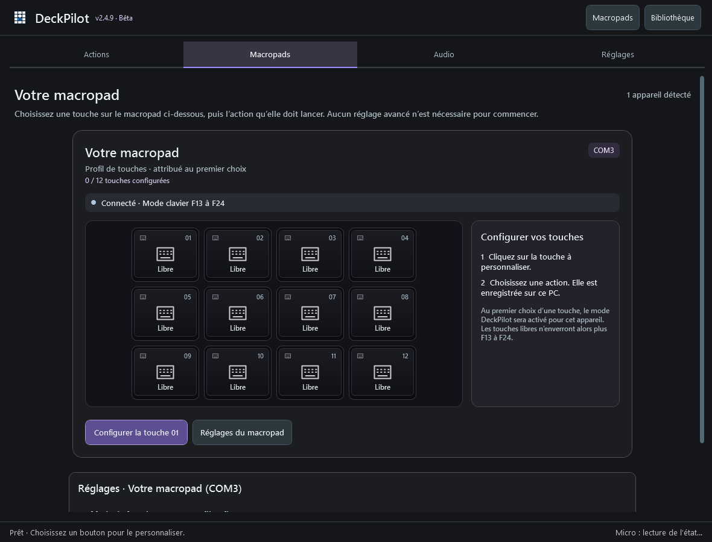
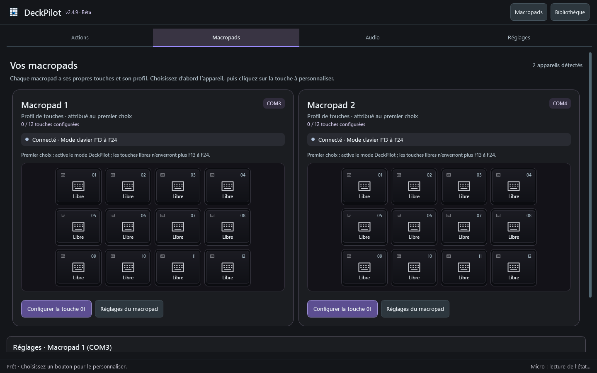

  
  

<h1 align="center">DeckPilot</h1>

  A Windows companion to my DIY macropad. 
  I made it to turn twelve physical keys into actions I can change whenever I need.

  <a href="https://github.com/lolo34dr/deckpilot/releases/latest">Download the latest release</a>
  &nbsp;·&nbsp;
  <a href="#quick-start">Quick start</a>
  &nbsp;·&nbsp;
  <a href="https://github.com/lolo34dr/deckpilot/issues">Issues and ideas</a>

  
  
  

  <a href="README.md">🇬🇧 English</a> ·
  <a href="docs/i18n/README.fr.md">🇫🇷 Français</a>

---

## Why I made it

I wanted to configure a small DIY macropad in Windows without hard-coding each key to one application. DeckPilot lets me choose what a key does, keep different layouts in profiles, and change them from the macropad itself.

It works with compatible Arduino Leonardo or Pro Micro boards that send **F13–F24**. Firmware **1.2.0** can keep up to two macropads on separate profiles. The Windows interface is currently in French.

## Quick start

1. Download and run **[DeckPilot-Setup.exe](https://github.com/lolo34dr/deckpilot/releases/latest/download/DeckPilot-Setup.exe)**. The .NET runtime is included.
2. Connect the macropad, start DeckPilot and open **Macropads**.
3. Select the device, click a key, then choose an action. If the on-screen key order does not match the physical buttons, use **Calibrer les touches**.
4. With firmware 1.2.0, the first assigned action enables DeckPilot mode for that device. Unassigned keys stop sending F13–F24 until you switch back to keyboard mode.

## What it looks like

I captured these screens on Windows during the 2.4.9 beta review. The COM ports and empty keys are from that test setup.

See the two-macropad layout

## Optional extras

The app also has a soundboard and microphone filter, plus **DeckPilot Atelier** for flashing and checking boards. They are optional parts of the project, so I keep their instructions separate:

- [Soundboard and microphone guide](docs/SOUNDBOARD.md)
- [Guide utilisateur en français](docs/USER_GUIDE.fr.md)
- [Atelier workshop guide](docs/FACTORY.md)
- [Firmware wiring, compatibility and recovery](firmware/README.md)
- [User guide](docs/USER_GUIDE.md)
- [Roadmap](ROADMAP.md)
- [Release history](CHANGELOG.md)
- [Contributing and issue reports](CONTRIBUTING.md)

## A couple of things to know

Setup needs administrator approval to install under **Program Files**. The published installers are unsigned, so Windows SmartScreen may show a warning. Setup also checks for the signed third-party VB-CABLE driver and installs it if it is missing; this needs an internet connection and administrator approval. VB-CABLE is only needed for soundboard mixing.

While DeckPilot is running, it listens for F13–F24 globally in the current Windows session so macropad actions work while another app is active. Physical F13–F24 keys on that PC use the same configuration.

The project is under the [MIT License](LICENSE). The French overview is maintained by hand. The issue list is the place to report a reproducible problem or suggest what I should improve next.
