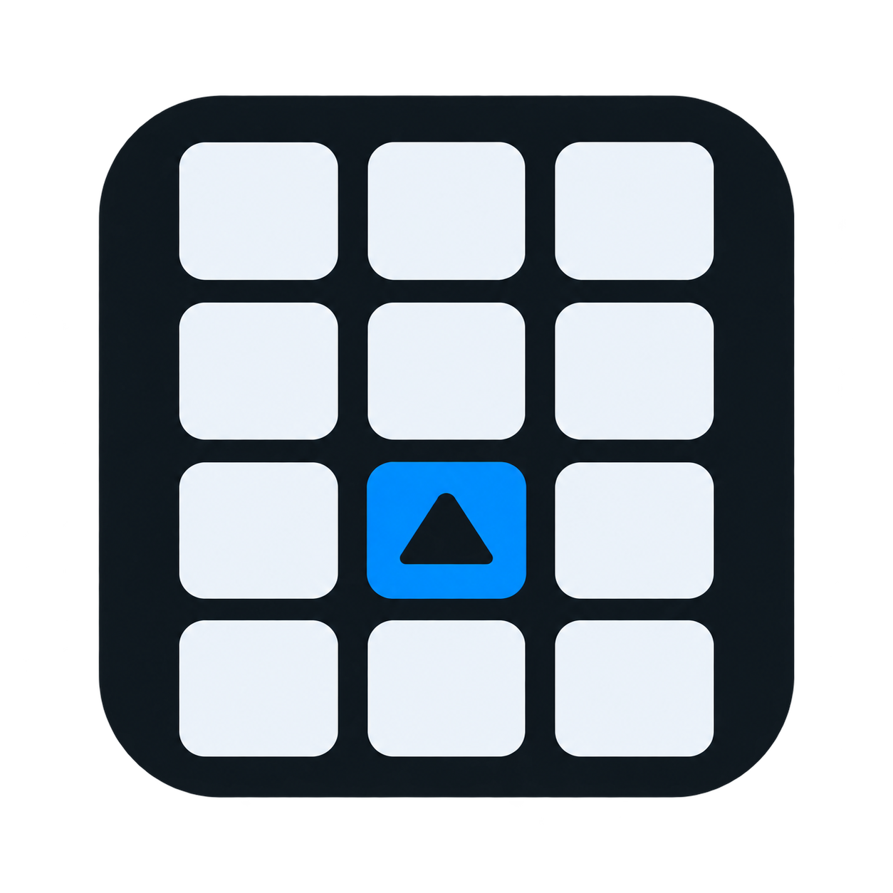

<h1 align="center">DeckPilot</h1>

Votre compagnon Windows pour un macropad de 12 touches.

  
  
  
  
  

  <a href="../../README.md">🇬🇧 English</a> ·
  <a href="README.fr.md">🇫🇷 Français</a> ·
  <a href="README.de.md">🇩🇪 Deutsch</a> ·
  <a href="README.es.md">🇪🇸 Español</a> ·
  <a href="README.it.md">🇮🇹 Italiano</a> ·
  <a href="README.pt-BR.md">🇧🇷 Português brasileiro</a> ·
  <a href="README.nl.md">🇳🇱 Nederlands</a> ·
  <a href="README.pl.md">🇵🇱 Polski</a> ·
  <a href="README.ru.md">🇷🇺 Русский</a> ·
  <a href="README.ja.md">🇯🇵 日本語</a> ·
  <a href="README.ko.md">🇰🇷 한국어</a> ·
  <a href="README.zh-CN.md">🇨🇳 简体中文</a> ·
  <a href="README.ar.md">🇸🇦 العربية</a>

DeckPilot configure les touches F13–F24 de votre macropad compatible Arduino Leonardo, disposées en 3 lignes de 4. Un calibrage guidé permet de retrouver les positions, même si le câblage est dans un ordre différent.

## Fonctionnalités

- Lancer des applications installées, ouvrir des dossiers et des sites, ou envoyer des raccourcis clavier.
- Contrôler Spotify séparément des commandes multimédias Windows, couper les micros et changer de sortie audio.
- Créer des profils et partir de modèles Musique, Productivité ou Création ; changer de profil depuis une touche.
- Configurer des appuis courts et longs, choisir les couleurs des touches et enregistrer un raccourci clavier.
- Glisser-déposer, copier/couper/coller, annuler/rétablir, importer/exporter et retrouver les sauvegardes automatiques.

## Installation

Windows 10 (version 2004 ou ultérieure) ou Windows 11, en 64 bits, et un câble USB de données sont nécessaires. Le runtime .NET est inclus.

1. Téléchargez DeckPilot-Setup.exe avec le bouton ci-dessus. Installez-le : Windows demande les droits administrateur pour Program Files. Les raccourcis Bureau/menu Démarrer et le lancement avec Windows sont proposés par défaut.
2. Branchez le macropad et suivez le calibrage : de gauche à droite, quatre touches par ligne, sur trois lignes. Chaque touche doit envoyer un F13–F24 différent.

## Utilisation

Sélectionnez une touche, choisissez une action dans la bibliothèque, réglez ses options et enregistrez. Vous pouvez modifier et tester les actions même lorsque la carte est débranchée. Une touche libre conserve son F13–F24 pour les jeux et les autres applications.

Fermer la fenêtre garde DeckPilot actif près de l’horloge. Utilisez le menu de cette icône pour quitter complètement. Spotify nécessite l’application Windows ouverte avec une session de lecture ; aucun repli sur YouTube n’est utilisé.

## Mises à jour et firmware

DeckPilot recherche les mises à jour au démarrage, puis toutes les six heures. Après votre accord, il télécharge et vérifie la mise à jour. Le programme d’installation peut demander une autorisation Windows. Les profils et le calibrage sont conservés.

Aucun pilote supplémentaire ni flash n’est nécessaire pour un macropad envoyant déjà F13–F24. Le firmware DeckPilot compatible apporte l’identité et les diagnostics ; consultez le guide matériel avant tout flash.

## Documentation et licence

Cette page traduit le guide utilisateur. L’interface de l’application est actuellement en français ; les références techniques détaillées et l’historique sont en anglais.

[English technical reference](../../README.md#development) · [Firmware & hardware](../../firmware/README.md) · [Release notes](https://github.com/lolo34dr/deckpilot/releases)

Licence MIT : vous pouvez utiliser, copier, modifier et redistribuer le logiciel en conservant la notice de copyright et la licence.

[MIT LICENSE](../../LICENSE)
