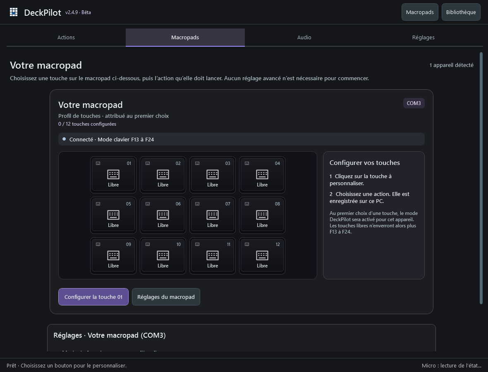
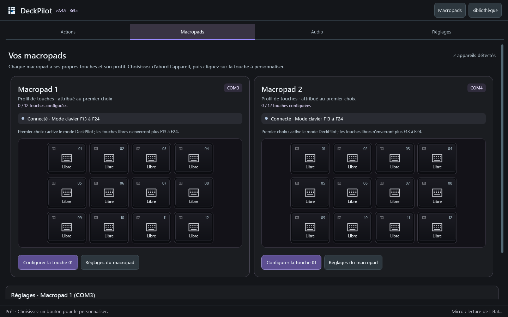

  <a href="../../README.md">🇬🇧 English</a> ·
  <a href="README.fr.md">🇫🇷 Français</a>

# DeckPilot

J’ai créé DeckPilot pour configurer mon macropad DIY dans Windows sans figer chaque touche sur une seule application. Je choisis l’action, je la garde dans un profil, puis je peux la changer depuis le macropad.

DeckPilot fonctionne avec les cartes Arduino Leonardo ou Pro Micro compatibles qui envoient les touches **F13–F24**. Avec le firmware **1.2.0**, deux macropads peuvent avoir des profils indépendants. L’interface de l’application est actuellement en français.

## Démarrage rapide

1. Télécharge et lance **[DeckPilot-Setup.exe](https://github.com/lolo34dr/deckpilot/releases/latest/download/DeckPilot-Setup.exe)**. Le runtime .NET est inclus.
2. Branche le macropad, démarre DeckPilot et ouvre **Macropads**.
3. Choisis l’appareil, clique sur une touche puis sélectionne une action. Si l’ordre à l’écran ne correspond pas aux boutons, lance **Calibrer les touches**.
4. Avec le firmware 1.2.0, la première action assignée active le mode DeckPilot pour cet appareil. Les touches non configurées n’envoient alors plus F13–F24 ; repasse en mode clavier pour les utiliser directement.

## À quoi ressemble la configuration

J’ai capturé ces écrans sous Windows pendant les essais de la bêta 2.4.9. Les ports COM et les touches vides viennent de cette configuration de test.

Voir la disposition pour deux macropads

## Audio et préparation du matériel

Le soundboard, le filtre de microphone et **DeckPilot Atelier** restent des fonctions optionnelles, expliquées séparément :

- [Guide du soundboard et du microphone](../SOUNDBOARD.fr.md)
- [Guide utilisateur](../USER_GUIDE.fr.md)
- [DeckPilot Atelier](../FACTORY.md)
- [Câblage, compatibilité et récupération du firmware](FIRMWARE.fr.md)
- [Guide utilisateur détaillé (anglais)](../USER_GUIDE.md)
- [Feuille de route](../../ROADMAP.fr.md)
- [Historique des versions (anglais)](../../CHANGELOG.md)
- [Contribuer et signaler un problème](../../CONTRIBUTING.md)

## À savoir avant l’installation

L’installation demande les droits administrateur pour installer DeckPilot dans **Program Files**. Les exécutables publiés ne sont pas signés ; SmartScreen peut afficher un avertissement. Setup vérifie aussi si le pilote tiers signé VB-CABLE est présent et l’installe s’il manque. Cette étape demande une connexion Internet et les droits administrateur. VB-CABLE ne sert qu’au soundboard.

Pendant que DeckPilot fonctionne, il écoute les touches F13–F24 dans la session Windows afin que le macropad puisse déclencher une action même quand une autre application est active. Les touches physiques F13–F24 du PC suivent la même configuration.

DeckPilot est sous licence [MIT](../../LICENSE). Pour signaler un bug ou proposer une amélioration, consulte la [liste des problèmes](https://github.com/lolo34dr/deckpilot/issues).
